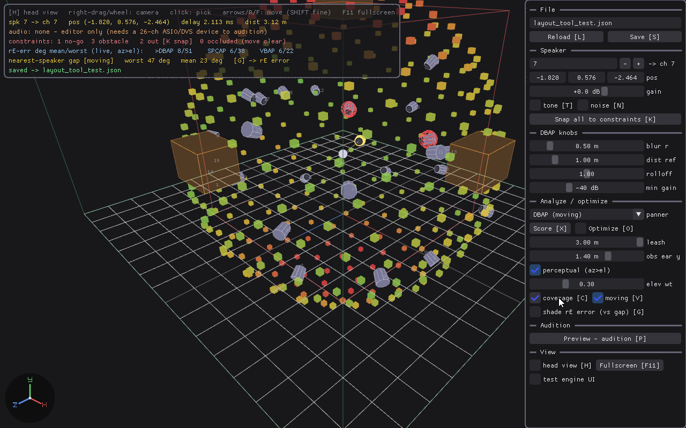
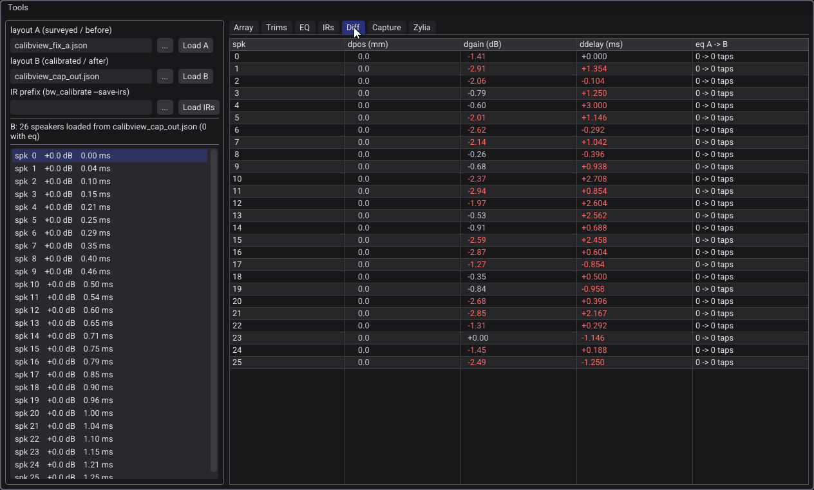
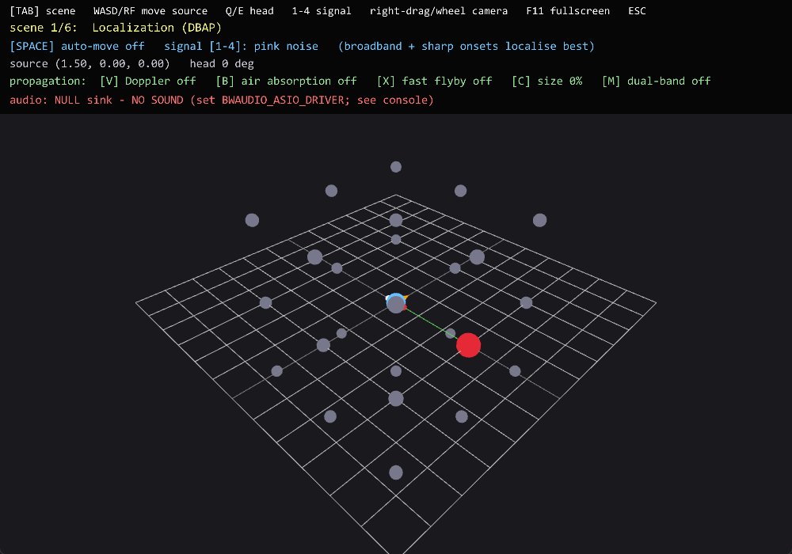

# bw_audio

Self-hosted spatial audio engine for a CAVE installation. It drives a speaker array (up
to 64 channels; the CAVE starts with 24, with room to grow) over ASIO into an RME Digiface Dante. A second path
does **binaural headphone rendering** through an HRTF (head-related transfer function): a first-class direct render, plus an array-audition monitor
for desk-side debugging. Game engines and experiment frameworks connect as thin
control clients over a C ABI. No rendered audio crosses that boundary, only control.

New to the vocabulary? [docs/glossary.md](docs/glossary.md) defines every term the docs use,
grouped by topic. Each entry says what the term means for a decision.

**Hear it now.** The engine runs in a browser: [aforren1.github.io/cave-audio](https://aforren1.github.io/cave-audio/)
is the minimal orbit and the six-scene playground, the same WebAssembly build of the same
code, on headphones. The playground runs a generated 24-speaker dome by default. Chromium is what it is tested in. Every push to main redeploys it.

## Status

Every subsystem is implemented and covered off hardware: the ctest suite, cross-validation
goldens against independent implementations, the simulate modes of the calibration and
validation tools, and off-wire parser tests.

**Nothing is verified on the rig yet.** Do not read a green test run as a working
speaker array. These parts need the hardware:

- the multichannel ASIO path into the Digiface, and the full-duplex capture that both
  measurement tools use,
- live Motive tracking. The NatNet parser and its lifecycle are tested off-wire only. That
  covers the head tracker, the optical speaker check and the tracked stand for the
  ZM-1 (the Zylia 19-capsule measurement microphone), including the assumption that Motive sends marker offsets in the body's own frame.
- the Zylia channel order and azimuth reference. Both survive every off-hardware check,
  and both report a confident wrong direction if they are wrong. So does the ZM-1's rigid
  sphere, which bends the arrival differences away from the free-field model the
  simulation uses.
- the live-aiming rate (about one reading a second in simulation, never timed on the rig).
- the by-ear checks: HRTF quality, the A/B/X knob bake-off, room EQ on the array.

[`docs/hardware-validation.md`](./docs/hardware-validation.md) is the ordered runbook for
that day. The Unreal binding is planned and not written.

## Shape

```
 control client (Unity / Godot / Python / MATLAB) ──control──┐
 OptiTrack (NatNet) ─────────────────────────────────pose────┤
                                                             ▼
                      ┌─ voice playback ─ DBAP pan ─► speaker bus ──────┐
                      │  (one audio callback)                           │
                      └─────────────────────────────────────────────────┘
                                  │                         │
                          ASIO ► Digiface ► array        HRTF decode ► stereo
                          (production)              (binaural render / array sim)
```

## Engine features

The catalog, with the calls behind each item, is
[docs/api.md, "Feature overview"](./docs/api.md#feature-overview). In short:

- **Spatialization**: listener-relative DBAP (distance-based amplitude panning) re-solved
  every block from the tracked head. SPCAP (speaker-placement correction amplitude
  panning) and VBAP (vector base amplitude panning) are there for a fixed listener.
- **Source extent**: angular spread (a lobe, or an MDAP (multiple-direction amplitude
  panning) ring) or a metric size, with velvet-noise decorrelation, a hole-aware floor and
  a multi-listener compromise for up to 4 occupants.
- **Head-following modifiers**: CAP (compensated amplitude panning) holds the interaural
  time difference as the head turns. Tracked alignment and tracked directivity re-aim the
  per-speaker trims and the speakers' off-axis loss onto the live head.
- **Acoustics**: with Steam Audio, ray-traced occlusion, a reflection bed and sound
  pathing. In any build, image-source early reflections, a directional FDN (feedback delay
  network) reverb and manual occlusion.
- **Propagation**: distance attenuation, Doppler, air absorption, equal-loudness
  compensation and pitch, opt-in per source.
- **Assets**: WAV/FLAC/MP3 resampled at load, disk streaming, push sources fed from your
  PCM, a refcounted shared cache with async loading, and AmbiX/FuMa ambisonic beds.
- **Voices**: priority stealing, pause, click-free seek and stop, fades, mix groups,
  sample-accurate scheduling, play regions, gapless queues, and end and loop-wrap events.
- **Tracking**: OptiTrack NatNet parsed in-process, pose prediction, and low-frequency
  (LF) room EQ interpolated at the live listener position.
- **Headphones**: a direct binaural render through an HRTF, an array-audition monitor
  (`cave_sim`), and AutoEq headphone correction.
- **Real-time discipline**: no allocation, locks or I/O on the audio thread, lock-free
  rings, frame-coherent commits, ramps on every change. Profiling via Tracy or a built-in
  headless profiler.
- **Offline and diagnostics**: the manual sink lets you pump blocks yourself
  (`bwa_render_block`), plus a test signal, meters and a direct single-speaker route.
- **Validation**: the core math is cross-checked against independent implementations in
  CI, and `bwa_validate` measures where the array actually puts a phantom.

## Control clients

The audio code is the same for all of them. They differ only in how they read transforms
and tracking at the boundary. See [`docs/integration.md`](./docs/integration.md).

| client | form | audience |
|---|---|---|
| [Unity](./bindings/unity/) | UPM package `com.brainworks.bw_audio`, P/Invoke plus `Engine` and `Emitter` components | games, the CAVE show |
| [Godot](./bindings/godot/) | GDExtension addon, one class per handle; the by-ear playground ships inside it | games, the CAVE show |
| [Python](./bindings/python/) | nanobind wheel, a raw 1:1 layer plus a Pythonic one | PsychoPy experiments |
| [MATLAB and Octave](./bindings/matlab/) | classic C MEX toolbox, one gateway on subcommand strings | Psychtoolbox experiments |
| [Web](./bindings/web/) | ES module over the WebAssembly build: a raw 1:1 layer plus an `Engine` layer, the control thread on a Worker, output through a Wasm Audio Worklet | browser demos and headphone experiments |
| Unreal | planned, notes only | games |

## Recommended settings per setup

The defaults target the CAVE: one tracked listener roaming the array. A fixed seat, an
audience or a desk with headphones each want different settings, mostly because a sweet spot
either exists or it doesn't. The per-setup table and the reasons are in
[docs/api.md, "Recommended settings per setup"](./docs/api.md#recommended-settings-per-setup).

## Non-goals and current limitations

bw_audio is not middleware. There are no events, banks, mixer graphs, or authoring
app: the ABI is create/play/position/commit. Game-side audio (UI, menus) stays in
the game engine's own mixer.

- **Fixed target.** The speaker geometry, including the channel count, is data.
  A layout file carries 4 to 64 speakers (`BWA_MAX_CHANNELS`) and the engine's channel
  count follows it, so a collaborator's array of any size in that range loads into the
  same binary. With no layout file, the engine runs a built-in 26-speaker grid
  (`BWA_DEFAULT_GRID`). Still not a general 5.1/Atmos renderer.
- **One *tracked* listener.** The multi-listener mode is a panning compromise for
  extra occupants, not per-head rendering.
- **The array is a Windows path.** ASIO is Windows-only and the Digiface is a Windows
  and macOS device. Everything else builds and runs everywhere (see
  [Platforms](#platforms-and-licensing)).
- **Room EQ is opt-in.** Static-listener correction at one point
  (`bwa_calibrate --room-eq`, fixed-seat installs), or **tracked room EQ** from a
  measured grid (`--room-eq-grid`) for a roaming listener: LF modal cuts only.
  Mid/HF stays speaker-only correction, because you cannot flatten one room for
  every position at once.

**Steam Audio is optional.** A no-SDK build is fully viable for the array: the whole
spatializer plus geometric early reflections, FDN reverb, and manual occlusion. The
SDK adds ray-traced (automatic) occlusion, sound pathing, and the real HRTF monitor.
That last one is a *developer-workstation* dependency, since the production array
render never uses HRTF. Which reverb/reflection path to run is a genuine choice.
[`docs/materials.md`](./docs/materials.md) has the comparison and the recommendation.

Current gaps (may change):

- Early reflections model a **shoebox** (the image-source path); arbitrary virtual
  geometry needs the Steam scene.
- Mono point sources only. Stereo and multichannel assets downmix; the ambisonic bed is
  the only non-point path.
- No completion callbacks. Ends and loop wraps come back as events you drain
  (`bwa_poll_ended`, `bwa_poll_looped`), never as a call into your code.
- No OGG/Opus. Seek, pitch, play regions, and the gapless queue apply to in-memory
  sounds only: a streamed or push source reads its ring in sequence and ignores them.
- Reverb bed configuration is load-time (`bwa_reflections_config`, `bwa_fdn_config`).
  Room geometry, occlusion meshes, and the FDN's decay do change live.

## Getting started

A default build vendors nothing by hand: dr_wav, dr_flac, dr_mp3, and cJSON are fetched
by CMake. Without the ASIO SDK the library still builds and links on Windows: the
headphone profiles open a WASAPI device, and the array profiles fall back to the offline
sink.

```
cmake -S . -B build -A x64
cmake --build build --config RelWithDebInfo
ctest --test-dir build -C RelWithDebInfo
```

Two dependencies are yours to fetch and neither is committed here. The ASIO SDK (the
production array path) goes in `third_party/asiosdk`. Steam Audio is a git submodule at
`third_party/steam-audio-source`, built once by `tools/phonon/build-phonon.sh` and linked
statically, so there is no second file to ship.
[`third_party/README.md`](./third_party/README.md) has both recipes.

The bindings are opt-in flags on the same configure: `-DBWA_BUILD_GODOT=ON`,
`-DBWA_BUILD_PYTHON=ON`, `-DBWA_BUILD_MATLAB=ON`. To build them against an engine you
already have, install it as an SDK (`cmake --install build --prefix <sdk> --component
bwa_sdk`) and configure with `-DBWA_ENGINE_SDK=<sdk>`. That mode compiles nothing under
`src/`, so every binding links the same binary.

Usage docs live in [`docs/api.md`](./docs/api.md): quickstart, profiles, the threading
contract, coordinates, how-to guides for the common setups, error handling, environment
variables, then a per-call reference. [`examples/minimal.c`](./examples/minimal.c) runs
the whole client lifecycle and needs no hardware: it orbits a click around the listener's
head for six seconds. Every binding ships the same demo, so put headphones on and compare
them ([`docs/integration.md`](./docs/integration.md), "The minimal example").

```c
bwa_desc cfg = { .profile = BWA_PROFILE_BINAURAL, .sample_rate = 48000, .block_size = 256 };
bwa_engine* e = bwa_create(&cfg);
bwa_start(e);                                    // no output device? silent sink, keeps running

bwa_sound click = bwa_load_sound(e, "click.wav");  // WAV/FLAC/MP3, resampled at load
bwa_source s     = bwa_source_create(e);
bwa_source_play(e, s, click, /*loop*/ true);

// per frame, from one thread:
bwa_set_listener_pose(e, px,py,pz, qx,qy,qz,qw);
bwa_source_set_pos(e, s, x, y, z);
bwa_commit(e);
```

## Documentation

| doc | covers |
|-----|--------|
| [`docs/api.md`](./docs/api.md) | usage guide + per-call reference |
| [`include/bw_audio.h`](./include/bw_audio.h) | the C ABI |
| [`docs/architecture.md`](./docs/architecture.md) | system overview, the bus seam, locked decisions |
| [`docs/signal-flow.md`](./docs/signal-flow.md) | the same signal-flow diagram, rendered |
| [`docs/concurrency.md`](./docs/concurrency.md) | threading model, rings, commit snapshot, lifetimes |
| [`docs/spatialization.md`](./docs/spatialization.md) | DBAP/SPCAP/VBAP, dual-band, binaural decode, alignment |
| [`docs/materials.md`](./docs/materials.md) | occlusion, reflections, sound pathing |
| [`docs/backends.md`](./docs/backends.md) | the sink contract and every device backend |
| [`docs/backend-development.md`](./docs/backend-development.md) | backend design rationale, phases, adding and verifying a backend |
| [`docs/integration.md`](./docs/integration.md) | the five bindings, coordinate seam |
| [`docs/layout-schema.md`](./docs/layout-schema.md) | `cave_layout.json` format |
| [`docs/layout-authoring.md`](./docs/layout-authoring.md) | authoring a layout with `bwa_layout_tool`, scoring and the optimizer |
| [`docs/calibration.md`](./docs/calibration.md) | trims, EQ, acoustic and optical survey, aiming, placing the mic, room report |
| [`docs/validation.md`](./docs/validation.md) | `bwa_validate`: grading the array's phantom images |
| [`docs/hardware-validation.md`](./docs/hardware-validation.md) | the rig-day runbook and its pass criteria |
| [`docs/glossary.md`](./docs/glossary.md) | one-line definitions for the whole vocabulary |
| [`docs/build.md`](./docs/build.md) | platform, dependencies, licensing, Dante config |
| [`docs/web.md`](./docs/web.md) | the WebAssembly target: toolchains, the worklet sink, the binding, hosting, what is measured |

Contributor-facing notes live in [`docs/internal-types.md`](./docs/internal-types.md),
[`docs/profiling.md`](./docs/profiling.md), and `CLAUDE.md` (agent working notes, not
user documentation).

## Tools

The tools are opt-in. Listed in workflow order: design, calibrate, grade, audition.

```
cmake -S . -B build -DBWA_BUILD_PLAYGROUND=ON -DBWA_BUILD_CALIBVIEW=ON -DBWA_BUILD_CALIBRATE=ON
cmake --build build --config RelWithDebInfo
```

`bwa_layout_tool` and `bwa_playground` are raylib plus Dear ImGui and build on Windows and
Linux. `bwa_calib_view` and the capture tools (`bwa_calibrate`, `bwa_validate`,
`bwa_zylia_probe`) are Windows-only, because they run a full-duplex ASIO host.
`bwa_speaker_survey` builds everywhere: it needs only the NatNet stream. All three GUI tools
run their UI test suites under ctest (`--tests`), and the screenshots below come from those
runs. Off Windows the raylib suites need a display: an X or Wayland session, or `xvfb-run`.

### Design: `bwa_layout_tool`



Authors `cave_layout.json`: place the speakers (4 to 64), identify each one by ear, shade
coverage by the selected panner's predicted localization error, and optionally optimize
the positions. Launch it from the build directory as `bwa_layout_tool [layout.json]`. Headless:
`--export`, `--score`, `--optimize`. See
[docs/layout-authoring.md](./docs/layout-authoring.md#authoring-with-bwa_layout_tool).

### Calibrate: `bwa_calib_view`



The calibration station for a rig day. Its Session tab runs every step in order (frame check,
positions, capsule survey, live aiming, trims, verify, room-EQ grid, validation), each through
the tested command-line tool, and **simulate** rehearses the whole day with no hardware.
`bwa_calibrate` is the same pipeline headless, and `bwa_zylia_probe` is a console level meter.
Neither has met the rig yet. See
[docs/calibration.md, "Calibrate a rig in `bwa_calib_view`"](./docs/calibration.md#calibrate-a-rig-in-bwa_calib_view).

### Grade: `bwa_validate`

Calibration fixes the array. This grades it: it renders a phantom through the real engine
core, measures where a Zylia ZM-1 says it landed, and reports the angular miss and the comb
depth against a single-speaker floor. `--simulate` runs it with no hardware. Same
`-DBWA_BUILD_CALIBRATE=ON` switch. See [docs/validation.md](./docs/validation.md).

### Audition: `bwa_playground`



The array sim (`cave_sim`) on headphones by default. The render picker switches to
`binaural` or to `cave` (the real array over ASIO). Pick a device in the panel, or pass
`--device <name or id>` (`--list-devices` prints them). With no device the engine keeps
rendering silently, so the 3D view still shows the panner driving the speakers.

The layout comes from, in order: the argument (`bwa_playground my_layout.json`),
`./cave_layout.json`, the generated 24-speaker dome (`examples/dome_24.json`, copied next to
the exe), then the built-in 26-speaker grid. The startup line says which one loaded. The web
and Godot playgrounds default to the same dome.

Scenes: localization, occlusion and materials, directivity, channel walk, reverb bed, an
underwater medium boundary, and a blind A/B/X knob comparison scored with a binomial
p-value. The Godot addon ships a port. The browser playground under
[`bindings/web/playground/`](./bindings/web/playground/) ports the scenes to three.js, minus
the reverb bed, and needs no build.

## Platforms and licensing

Windows is the production platform. Nothing outside a `*_sink` file is platform-bound,
so the library, the tests, the console examples, and the two raylib tools
(`bwa_layout_tool`, `bwa_playground`) build with MSVC, gcc, and clang.

| platform | array | headphones |
|---|---|---|
| Windows | ASIO into the Digiface | WASAPI, shared mode by default |
| Linux | JACK or ALSA, through a multichannel card or AES67 into the Dante net. Neither route is tested. | JACK or ALSA |
| Android | none. Android carries no array transport. | AAudio, stereo only |
| macOS | none yet | none yet. CoreAudio is specified, not written. |
| Web | none | a Wasm Audio Worklet, stereo. Emscripten with threads, so the page must be cross-origin isolated |

macOS runs the null and manual sinks, so the offline render path works there and nothing
reaches a speaker. The web build keeps the engine's two-thread model over
`SharedArrayBuffer`, which is why it needs the isolation headers; on GitHub Pages a service
worker supplies them. A wasi-sdk build of the same core runs the offline suite under
wasmtime and is the CI leg. [`docs/backends.md`](./docs/backends.md) has the sink contract
and the per-backend rules, [`docs/web.md`](./docs/web.md) the browser side.

**GPLv3** ([`LICENSE`](./LICENSE)). Third-party components keep their own licenses; see
[`docs/build.md`](./docs/build.md) and
[`THIRD_PARTY-NOTICES.md`](./THIRD_PARTY-NOTICES.md).
